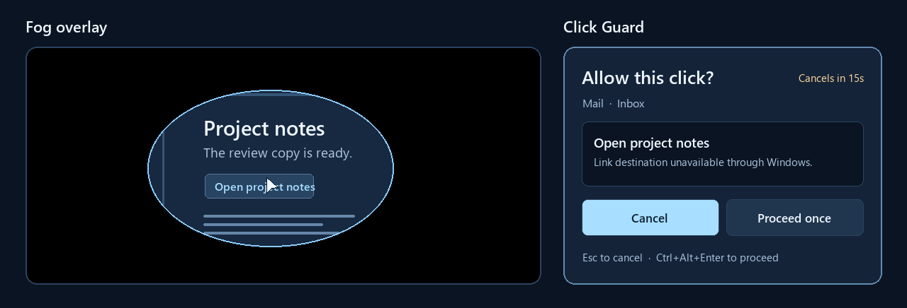

# NarrowVision

**A Windows 11 privacy overlay that reveals only the area around your cursor.**

NarrowVision starts with pure black fog outside a clear, cursor-following area. Use it to make your screen harder to read over your shoulder, limit what is visible in a compatible full-display share, or focus on one part of a busy desktop. The optional **Click Guard** gives you a chance to review a mouse click before it reaches an app.

A [Novus Mercatura](https://novusmercatura.com) product.



[**Download for Windows 11 (x64)**](https://github.com/ultros/NarrowVision/releases/latest/download/NarrowVision-win-x64.zip) · [Releases](https://github.com/ultros/NarrowVision/releases) · [License](LICENSE)

## When it helps

| Situation | How NarrowVision helps |
| --- | --- |
| **Shoulder surfing** in an office, café, or shared workspace | Keep the rest of the display black while you read one email, field, or document section. People nearby can still see the area you reveal. |
| **Remote viewing** during a screen share or support call | A tool that shares the composited full display can show the same fog as your monitor. Check the viewer's preview before sharing sensitive content. |
| **Unexpected clicks** on links, buttons, and menu items | Hold covered clicks for a deliberate **Proceed once** or **Cancel** decision. An unanswered prompt cancels automatically. |
| **A busy desktop** across one or more displays | Hide surrounding windows and controls while you work in a small area. Switch to a wider preset or pause when you need the full view. |

### Screen-sharing limits

NarrowVision draws over the desktop you see. Full-display sharing can include that overlay. Sharing an individual window can expose the underlying window because Windows can capture it separately. A remote operator who controls the cursor can move the clear area. Remote access and recording controls remain with Windows and the sharing software. [Microsoft's screen capture documentation](https://learn.microsoft.com/en-us/windows/uwp/audio-video-camera/screen-capture)

## Get started

1. Extract `NarrowVision-win-x64.zip` and open `NarrowVision.exe`. The portable build includes the .NET desktop runtime and runs with your normal Windows permissions.
2. Move your pointer to see through the fog. The **Width** and **Height** sliders change how much of the screen you reveal. The preview shows your settings before you close the window.
3. Turn on **Click Guard** if you want to review clicks. Use **All primary clicks** when you want the broadest coverage.
4. Minimize or close settings to keep NarrowVision in the notification area near the clock. Right-click the tray icon to reopen settings, change protections, load your default, pause, or exit.

## Startup and profiles

- **Start with Windows** opens NarrowVision in the tray when you sign in. It is off by default. Enable it from the dashboard or the right-click tray menu. If you move the executable later, toggle the setting off and on from the new location.
- **Save as default** records the current fog and Click Guard choices as the profile to use whenever the app starts.
- **Load default** applies the saved profile immediately. **Clear default** removes that saved profile so the most recent settings are used at the next launch.

## Fog overlay

| Setting | Options |
| --- | --- |
| **Mode** | Reveal around the cursor or dim the area around it |
| **Shape** | Ellipse or rounded rectangle |
| **Size** | Independent width and height with Small, Medium, and Wide presets |
| **Darkness** | Adjustable up to fully black at 100% |
| **Soft edge and outline** | Keep the hard edge used by default, soften the boundary, or show a guide |
| **Displays** | Cover all displays or only the one with the cursor |

The overlay passes mouse input through. Width, height, and soft edge are measured in device-independent pixels.

## Click Guard

Click Guard is off on first launch. Enable it in settings or with **Ctrl+Alt+F9**.

- **All primary clicks** asks before sending a primary click to another app. The optional middle-click setting is on by default to cover actions such as opening browser links in new tabs.
- **Links, buttons and other controls** asks about recognized actions and unknown targets. It can let clicks on text and document surfaces through based on what the app reports to Windows. Custom controls may be labeled incorrectly.
- **Cancel** discards the pending click. **Proceed once** rechecks the original window and location, and rechecks the accessible target when Windows supplied one. The prompt cancels if focus changes or the configurable timer expires.
- The prompt shows the source app and any available control label. Whether a link is safe and where it leads are outside the scope of the click review.

The guard works on covered mouse messages in the interactive desktop. Keyboard activation, secure Windows screens, and app actions that bypass those mouse messages fall outside its coverage. Windows can prevent replay into elevated apps. Guarded drags and modified clicks are canceled. Pause or toggle Click Guard for drag-and-drop or text selection.

## Keyboard shortcuts

| Shortcut | Action |
| --- | --- |
| <kbd>Ctrl</kbd>+<kbd>Alt</kbd>+<kbd>F8</kbd> | Toggle the fog |
| <kbd>Ctrl</kbd>+<kbd>Alt</kbd>+<kbd>F9</kbd> | Toggle Click Guard |
| <kbd>Ctrl</kbd>+<kbd>Alt</kbd>+<kbd>F10</kbd> | Open settings |
| <kbd>Ctrl</kbd>+<kbd>Alt</kbd>+<kbd>F11</kbd> | Pause both features for five minutes or resume early |
| <kbd>Esc</kbd> | Cancel the pending click |
| <kbd>Ctrl</kbd>+<kbd>Alt</kbd>+<kbd>Enter</kbd> | Proceed once when the prompt is active |

The prompt displays its keyboard shortcuts when Windows makes them available.

## Local data

NarrowVision keeps `settings.json` and the optional `default-profile.json` in `%LOCALAPPDATA%\NarrowVision`. Windows startup registration applies only to the current user. The overlay is drawn locally. Pending click locations and accessibility labels are used in memory for review and are never written to a click log.

## Build from source

Use the .NET 10 SDK on Windows.

```powershell
dotnet build -c Release
dotnet publish -c Release -r win-x64 --self-contained true -p:PublishSingleFile=true -p:IncludeNativeLibrariesForSelfExtract=true -o publish
```

## Copyright and license

Copyright © 2026 Novus Mercatura. NarrowVision's original code, documentation, and illustration are licensed under [Creative Commons Attribution 4.0 International](https://creativecommons.org/licenses/by/4.0/). The bundled .NET components retain their own licenses and notices. [Full license text](LICENSE)
